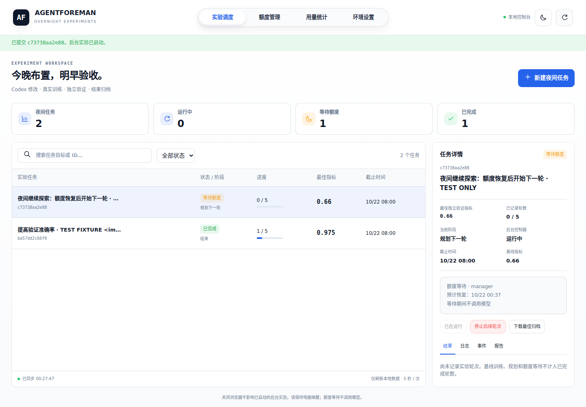

# AgentForeman

**Assign Codex an experiment tonight. Wait through quota resets without model calls. Review verified results tomorrow.**

## Cooperative and adversarial tasks (v0.10)

Use member-owned workers for general reports, data analysis and design artifacts:

- **Adversarial:** propose → independent checks → anchored criticism → revision
  → retest, bounded by round/time budgets. No-progress stops preserve disagreements.
- **Cooperative:** an integrator decomposes independent assignments, contributors
  run in parallel, then the combined result enters the same independent acceptance
  loop. Missing contributions block integration; reviewers cannot be contributors.

Both modes are available in **共享委员会 → 合作与对抗任务** in the local panel,
with task status, contributions, versions, receipts, pending questions, stop
controls and JSON/Markdown downloads. Keep `pool serve` and workers running;
durable task IDs and receipts support restart without resubmission.

Chair summaries are advisory. Passing status covers configured checks only;
agreement and source-quote matching do not establish general factual correctness.
[Cooperation and dashboard guide](docs/COOPERATIVE.md) ·
[Adversarial controls and CLI](docs/ADVERSARIAL.md).

Before using real accounts overnight, run `foreman pool smoke --project ./my-experiment --config ./member.toml`:
it exercises the configured provider through a private HTTP/native worker and
independently checks its output. Authentication, quota and execution failures
return nonzero exit status. [Live provider diagnostic guide](docs/WORKER_POOL.md#verify-a-real-provider-before-an-overnight-task).

The browser suite exercises both forms through concurrent HTTP workers with
scripted model replies and a real Python checker: failed result → criticism →
revision → passing retest. It also checks escaped content, downloads, mobile
layout and stopping. Live paid-model quality and overnight performance remain
unmeasured. Historical CI results below apply to their pinned commits.

Validation at `9575768`: local **159 Python tests** passed; all **nine native
Windows/macOS/Linux × Python 3.11/3.12/3.13 jobs** and the browser's **ten workflow
groups** passed in CI. [CI run](https://github.com/kumizeod/AgentForeman/actions/runs/40444781682)
· [Pinned evidence and fixture disclosure](evidence/cooperative-ci.json).

## Multiple coding agents (v0.9)

Codex, Claude Code and Gemini CLI can participate through the same durable worker
pool. An existing local LinJun/CLIProxyAPI endpoint can also supply an API worker.
Independent code candidates share a frozen base, are validated against the edit
allowlist, and are separately trained/verified before selecting the best archive.
The shared council panel can start an implementation round from its research plan.
[Multi-agent setup, boundaries and attribution](docs/MULTI_AGENT.md).

Validation at `b4290fc`: nine native Windows/macOS/Linux jobs passed **136 tests
each**, and the browser passed **eight workflow groups**, including independent
Codex/Claude code proposals, real training/verification and best-archive download.
[CI run](https://github.com/kumizeod/AgentForeman/actions/runs/40349365740) ·
[Evidence and fixture disclosure](evidence/multi-agent-ci.json).

## Shared overnight council (v0.8)

Pool your group's member-owned Codex workers and API workers: **independent answers
→ anonymous non-self peer review → Claude chair synthesis → independent audit**.
Each member keeps their local login; the coordinator stores worker-token hashes,
leases and task receipts. Quota cooldown, alternate eligible members, local night
windows and crash recovery are supported. No human approval stage is added. Delayed starts and an optional local verified
experiment handoff are available; measured project results attach to the report.

[小组夜间使用指南（中文）](docs/COUNCIL.zh-CN.md) · [Setup the worker pool](docs/WORKER_POOL.md) · [Run a council and inspect quality gates](docs/COUNCIL.md).
Model agreement is not verification; reports preserve source gaps, unresolved
findings and unexecuted tests. This is a candidate-answer workflow, not a promise
of correct novelty claims or distributed GPU training.

Validation at `0bd6f27`: all nine native jobs passed **123 tests each**, and the
browser job passed **seven workflow groups**, including three HTTP workers.
[CI run](https://github.com/kumizeod/AgentForeman/actions/runs/39976862723) ·
[Evidence and fixture disclosure](evidence/council-ci.json).

## Automatic proposal review (v0.7)

New tasks can run **proposal → independent review → revision → approved execution**,
with a bounded review budget and no human approval stage. Rejected or unresolved
plans stop automatically while retaining the best verified result. Discussion
jobs preserve quota waiting, deadlines and crash recovery. The panel exposes
criticism, proposer responses and transcript export.

Incremental update: stable issue IDs track repeated criticism and suggested tests.
Revisions that only change rhetoric or cycle back to an earlier instruction and
plan stop with `debate_stalled`, preserving the best result and outstanding issues.
The panel and JSON export distinguish reviewer clearance from experimental proof.

```powershell
python -m agentforeman overnight start --project .\my-experiment --goal "Improve validation accuracy" --deadline 08:00 --review --max-reviews 2
```

The initial implementation uses separate Codex CLI sessions, with optional
`[manager]` / `[reviewer]` model overrides. [Automatic review guide](docs/AUTOMATIC_REVIEW.md).

Validation at `c7d8982`: **all nine native jobs passed 96 tests each**, and the
browser job passed its six workflow checks. [CI results](https://github.com/kumizeod/AgentForeman/actions/runs/39967197118)
· [Machine-readable evidence and fixture disclosure](evidence/review-ci.json).

## Local control panel (v0.6)

The graphical panel is implemented, reusing actual MIT-licensed
[codex-tools](https://github.com/170-carry/codex-tools) styles and ported navigation
and quota components. Submit, monitor, stop/resume and inspect real experiments
from the browser; download their independently verified best replay archives.

```powershell
python -m pip install -e ".[demo]"
python -m agentforeman ui --project .\my-experiment
```

Works on native Windows, macOS and Linux. No Node/Tauri build is required.
[Panel guide](docs/WEB_UI.md) · [Source/license notices](NOTICE.md).

Validation: **86 tests passed in each Windows/macOS/Linux × Python 3.11/3.12/3.13
test step**, plus the Chromium browser workflow. [CI](https://github.com/kumizeod/AgentForeman/actions/runs/39627355613)
· [Exact job/step status and fixture disclosure](evidence/web-ui-ci.json).



*Browser-test screenshot: explicit test-only Codex replies, real training/verification
and durable quota waiting. No live account results are implied.*


v0.5 adds [quota visibility and local operations](docs/OBSERVABILITY.md): cached quota
windows, a terminal monitor, token accounting, sanitized diagnostics and optional
preflight waiting before new model jobs. The v0.5 implementation `b97b33a` passed
**80 tests on all nine Windows/macOS/Linux × Python 3.11/3.12/3.13 combinations**:
[native CI](https://github.com/kumizeod/AgentForeman/actions/runs/39609519359),
[machine-readable evidence](evidence/operations-ci.json).

v0.4 added [overnight assignments](docs/OVERNIGHT.md): detached submission, a morning
deadline, persistent quota waiting, model-free reset lookup, partial-code continuation
and a report explaining completed and unfinished work.

```powershell
python -m agentforeman overnight start --project .\my-experiment --goal "Improve validation accuracy within the checkpoint contract" --deadline 08:00 --max-rounds 5
python -m agentforeman overnight status CAMPAIGN_ID --project .\my-experiment
python -m agentforeman overnight report CAMPAIGN_ID --project .\my-experiment
```

Install/update the package and configure Codex first using the instructions below.
`08:00` means the next local 08:00. Keep the computer awake. See the overnight guide
for exact quota detection, reset fallback and recovery limits.

The final v0.4 implementation `646c63f` passed its 67-test suite on all nine
Windows/macOS/Linux × Python 3.11/3.12/3.13 combinations:
[native CI results](https://github.com/kumizeod/AgentForeman/actions/runs/39451247519).
Quota tests use explicit fixtures; live account reset behavior still needs validation.

AgentForeman is an early, local-first experiment manager. Its v0.3 campaign layer
asks a read-only Codex manager to propose an experiment, repair, retest or stop.
The controller validates decisions, enforces round/time limits, and invokes a
separate coding worker. Each run snapshots code, trains supervised processes,
verifies checkpoints independently, and archives evidence. Single-run commands
remain available. The small Python control plane uses psutil for native
Windows/macOS process identity and Windows process-tree cancellation.

[中文上手指南](docs/QUICKSTART.zh-CN.md) · [Architecture](docs/ARCHITECTURE.md) ·
[Overnight jobs](docs/OVERNIGHT.md) · [Campaign manager](docs/CAMPAIGNS.md) · [Recovery](docs/RECOVERY.md) · [Extending experiments](docs/EXTENDING.md) ·
[Roadmap](docs/ROADMAP.md) · [References](docs/REFERENCES.md)

## Status and scope

- Real Codex CLI adapter with JSON event logs and a structured handoff.
- Real CSV files, NumPy MLP optimization, NPZ checkpoints and detached processes.
- External evaluator recomputes predictions from checkpoint tensors; it does not
  import candidate code or accept the worker's claimed score.
- SQLite state, transactional event history, per-run/per-job locks, durable exit
  receipts, process birth identities and restart reconciliation.
- Source snapshots, exact patch, logs, metric comparison, SHA-256 manifest and a
  relocatable replay script in each completed experiment archive.
- Persistent multi-round campaigns: model-proposed decisions, validated action
  references, repair lineage, independent retests, immutable best snapshots,
  explicit round limits and elapsed wall-clock deadlines, including pauses.
- This is a single-machine manager MVP. Distributed scheduling, GPU leases,
  learned policies, token/money budgets and multi-user isolation remain future work.

**Validation disclosure:** the development environment had no Codex CLI or model
authentication available. Tests use an explicitly named **test-only CLI fixture**
for planning and source edits; training, validation, process supervision and archive replay run
for real. A live authenticated Codex run remains to be checked on the user's machine.
No production command silently falls back to a fixture. See `evidence/VALIDATION.md`.

## Requirements

- Native Windows, macOS or Linux (WSL2 is also supported), Python 3.11+, Git recommended.
- Codex CLI installed and authenticated for live editing.
- NumPy for the bundled example. No GPU or data download required for this example.
- A local durable filesystem with native file locking and SQLite; network filesystems
  and multi-host execution are outside this release's support boundary.

## Platform implementation and verification

| Platform | Native implementation | Verified in this delivery |
| --- | --- | --- |
| Linux / WSL2 | flock, /proc birth receipts, detached sessions/process groups | Full local integration suite on Linux |
| macOS | flock, psutil creation time, detached sessions/process groups | Native integration CI passed on Python 3.11/3.12/3.13 |
| Windows PowerShell | msvcrt byte locks, psutil creation time, detached supervisors, known-tree cancellation, npm shim resolution | Native integration CI passed on Python 3.11/3.12/3.13 |

The GitHub workflow runs the complete suite on Ubuntu, Windows and macOS with
Python 3.11/3.12/3.13. All nine combinations passed for the v0.3 implementation
commit `3a83afe`: [CI results](https://github.com/kumizeod/AgentForeman/actions/runs/39427543907).
These tests use explicit planner/editor fixtures; live Codex inference is still pending.
See [platform details](docs/PLATFORMS.md) for exact behavior and limits.

## Quick start

After installing and initializing a project using the platform instructions below,
start a bounded campaign (use your environment's Python on every OS):

```bash
python -m agentforeman campaign start --project ./my-experiment --goal "Improve validation accuracy within the checkpoint contract" --max-rounds 3 --budget-seconds 1800
python -m agentforeman campaign resume CAMPAIGN_ID --project ./my-experiment
python -m agentforeman campaign report CAMPAIGN_ID --project ./my-experiment
```

The manager uses your configured Codex CLI/login in a separate read-only session.
No extra model provider or fallback editor is installed. See [campaign behavior and recovery](docs/CAMPAIGNS.md).

From the extracted source directory, macOS/Linux:

```bash
python3 -m venv .venv
./.venv/bin/python -m pip install -e '.[demo]'
npm install -g @openai/codex
codex login
codex --version

./.venv/bin/python -m agentforeman init ./my-experiment
./.venv/bin/python -m agentforeman doctor --project ./my-experiment
./.venv/bin/python -m agentforeman start --project ./my-experiment \
  --goal "Improve validation accuracy; keep the checkpoint contract and use one coherent candidate."
```

Native Windows PowerShell (no WSL or venv activation required):

```powershell
py -3 -m venv .venv
.\.venv\Scripts\python.exe -m pip install -e ".[demo]"
npm install -g @openai/codex
codex login
codex --version
.\.venv\Scripts\python.exe -m agentforeman init .\my-experiment
.\.venv\Scripts\python.exe -m agentforeman doctor --project .\my-experiment
.\.venv\Scripts\python.exe -m agentforeman start --project .\my-experiment --goal "Improve validation accuracy with one coherent candidate."
```

In the remaining examples, `python` means that same environment's interpreter;
use `.\.venv\Scripts\python.exe` on Windows or `./.venv/bin/python` on macOS/Linux.
Windows npm `codex.cmd` is resolved to its package's Node entry without a shell.
Custom installations can set `[codex].command` to an explicit executable prefix.

`foreman` is also installed as a console command. The module form works even when
your shell's PATH does not include the console scripts directory.

The command prints a run ID **before** starting execution. Keep it. Codex runs
with `workspace-write` and no interactive approval prompts; actions that cannot
run under that sandbox fail visibly. We do not disable its sandbox automatically.
If the CLI's flags or authentication differ on your installation, inspect
`jobs/codex-00/stderr.log` and update `src/agentforeman/codex.py` deliberately.

You may first inspect the independently measured baseline without calling Codex:

```bash
python -m agentforeman start --project ./my-experiment \
  --goal "Improve validation accuracy" --until codex
```

`--until` pauses **before** the named phase. Resume with:

```bash
python -m agentforeman resume RUN_ID --project ./my-experiment
python -m agentforeman status RUN_ID --project ./my-experiment
python -m agentforeman events RUN_ID --project ./my-experiment
python -m agentforeman report RUN_ID --project ./my-experiment
```

## Interrupt and resume

Ctrl-C stops the **manager**. An active supervised job continues. Resume reattaches
to that job or consumes its existing result; it does not rerun completed phases.
Force-termination (POSIX SIGKILL or Windows TerminateProcess) is handled the same way on resume, although the
last stored status can still read `running` until reconciliation.

To terminate an active command instead:

```bash
python -m agentforeman cancel RUN_ID --project ./my-experiment
```

Failed phases require an explicit retry, after inspecting their logs:

```bash
python -m agentforeman resume RUN_ID --project ./my-experiment --retry-failed
```

Retries are new job attempts. A failed editing attempt is reset to the frozen
baseline before invoking Codex again. Failed training outputs are retained in
`failed_outputs/`; the next training attempt gets an empty artifact directory.
See [recovery semantics](docs/RECOVERY.md), particularly supervisor loss and reboot.

## Results

Completed evidence lives at:

`.foreman/runs/RUN_ID/archive.zip`

```bash
python -m agentforeman verify-archive ./my-experiment/.foreman/runs/RUN_ID/archive.zip
```

After extracting it to a directory:

```bash
python reproduce.py --baseline
python reproduce.py
```

`completed` means the workflow executed and verification passed. `objective_met`
separately records whether the candidate beat the baseline by the configured
delta. A worse candidate is a valid experiment, not a fabricated improvement.

The bundled task is synthetic two-moons classification with one fixed seed. It
validates the engineering loop, not general architecture-search performance.
Its supported checkpoint is a two-layer ReLU MLP; arbitrary architectures require
a corresponding trusted evaluator. Validation data are not a final research test set.

## Tests

```bash
python -m unittest discover -s tests -v
```

Tests actually kill managers, race supervisor launches, enforce timeout/cancel,
inject training crashes and unauthorized edits, reject symlinks, ignore fake
scores, detect archive tampering, and reproduce a trained candidate from an
extracted archive. The deterministic editing fixture is in `tests/` only.

## Trust boundary

This is a personal, trusted-project runner, not a hostile-code sandbox. Local
training runs with your user's permissions and inherited environment; source
hash checks detect accidental/prohibited edits but cannot isolate malicious code
running as the same OS user. Use a dedicated container/VM for untrusted projects.
Checksums detect corruption relative to the manifest; they are not signatures.
No auto-merge, publishing, package installation, or deployment is performed.

## License

MIT. This implementation is original; references are acknowledged without
vendoring their code.

## Quota visibility and local operations (v0.5)

Inspired by [codex-tools](https://github.com/170-carry/codex-tools), AgentForeman
now includes explicit quota snapshots, a terminal status panel, local token
accounting, sanitized diagnostics and an optional preflight quota guard:

```powershell
python -m agentforeman usage --project .\my-experiment --refresh --json
python -m agentforeman monitor --project .\my-experiment --watch
python -m agentforeman stats --project .\my-experiment --json
python -m agentforeman diagnostics --project .\my-experiment --json
python -m agentforeman overnight start --project .\my-experiment --goal "Improve validation accuracy" --deadline 08:00 --quota-preflight
```

Monitoring and cached views never launch Codex. Explicit refresh/preflight use
read-only metadata RPCs, with no model turns. Failed refreshes retain a clearly
stale snapshot. Missing token usage remains unknown. See
[quota and operations](docs/OBSERVABILITY.md) for exact semantics and reference attribution.
