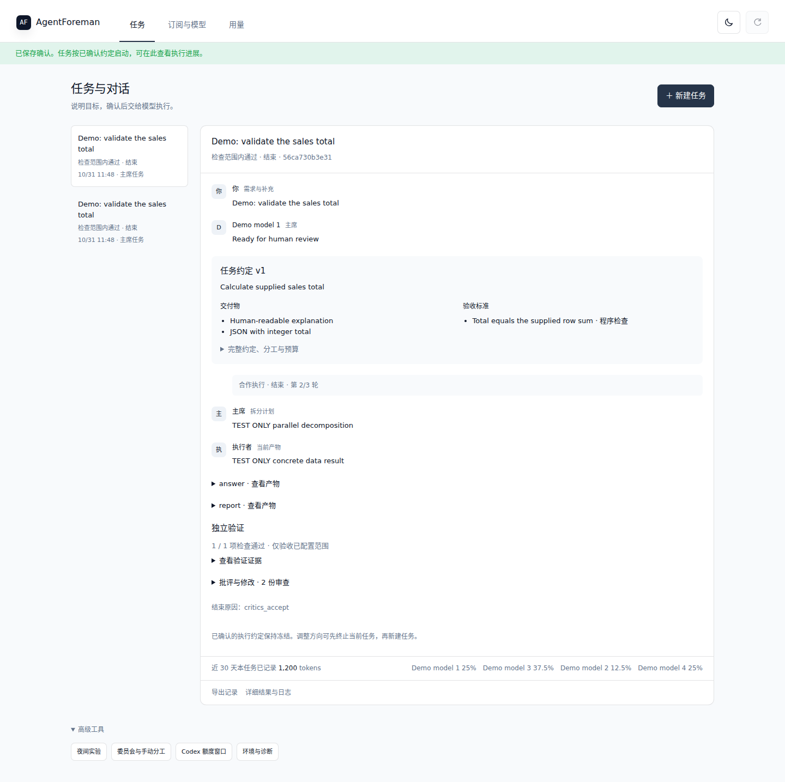
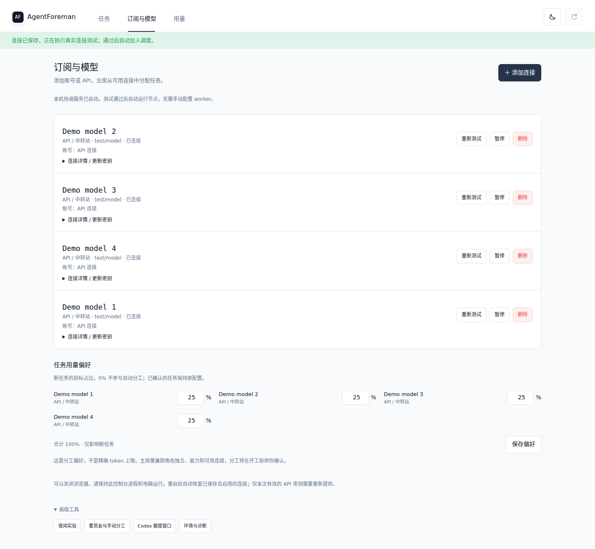
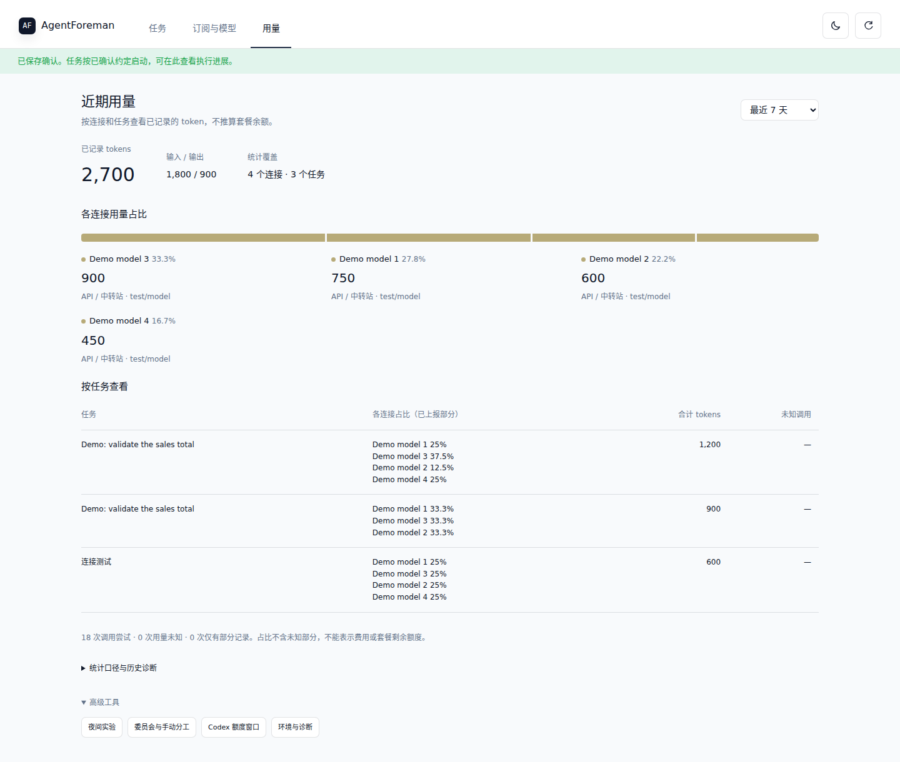

# AgentForeman

**Clarify a task. Coordinate your agents. Come back to evidence.**

AgentForeman is a local-first orchestration system for coding agents and other complex tasks. Connect your existing CLI clients or API providers, agree on a task with a chairman, and let a bounded multi-agent workflow produce, critique, revise and verify the result.

Built for overnight research experiments, code changes, data analysis and structured reports. Runs on **Windows, macOS and Linux** with Python 3.11+.

[Quick start](#quick-start) · [Interface](#interface) · [Workflows](#workflows) · [Documentation](#documentation) · [CI](https://github.com/kumizeod/AgentForeman/actions/workflows/tests.yml)

## Interface

Three main pages keep daily operations together: **Tasks**, **Subscriptions & Models**, and **Usage**. Advanced tools expose experiments, councils and diagnostics.

### Tasks and chairman conversation

Review the proposed goal, deliverables, acceptance checks and role assignments before confirming execution. Follow the conversation, artifacts, verification results and task status in one place.



### Subscriptions and model connections

Add and test local CLI or API connections, choose a preferred chairman, and set allocation preferences. Pause, retest or delete connections without erasing their historical usage.



### Token usage

Inspect client-reported token usage by connection and task over the last 1, 7 or 30 days. Target allocation and observed consumption are shown separately; missing usage stays unknown.



*Screenshots show the current application with scripted demonstration providers, not live subscription results. The interface currently uses Chinese labels; this README is in English. See [screenshot provenance](docs/assets/SCREENSHOTS.md).*

## What it does

- **Clarification before execution.** A chairman helps define a versioned task contract. Your confirmation freezes the reviewed goals, roles, evidence, checks and execution limits.
- **Cooperative execution.** An integrator splits work among contributors, combines their artifacts, and sends the result through independent review and acceptance checks.
- **Adversarial improvement.** A proposal enters a criticism → revision → retest loop. Criticism needs checkable anchors; round and time limits stop repetitive debate and preserve unresolved questions.
- **Multi-model councils.** Independent answers, anonymous non-self peer review, chair synthesis and an independent audit support research and analysis tasks.
- **Overnight experiments.** Codex edits an allowed scope, supervised processes train a candidate, an independent evaluator checks its checkpoint, and the system archives the result with replay instructions.
- **Durable scheduling.** SQLite state, worker leases, process identities and exit receipts support restart and reconciliation. Recognized quota resets become persistent waiting periods without model calls during the wait.
- **Execution controls.** Interrupt supervised calls, inspect cancellation acknowledgements and retain partial results. Offline or uncertain workers remain explicitly unconfirmed.
- **Connection-level accounting.** Aggregate reported tokens across jobs and retries without treating unknown usage as zero or pretending allocation percentages are hard token budgets.

## Quick start

### Requirements

- Python **3.11+** and a local filesystem supporting native locks and SQLite.
- At least one installed, authenticated CLI client or a supported API connection.
- Git to clone and update the repository. Node.js is only needed by clients that require it; the web panel needs no Node or Tauri build.

Automatic adversarial tasks require **at least three tested connection identities**; cooperative tasks require **at least four**. Multiple models on one account still share that account's capacity and do not establish model independence.

### Windows

```powershell
git clone https://github.com/kumizeod/AgentForeman.git
cd AgentForeman
.\start-windows.cmd
```

Or download and extract the repository, then double-click `start-windows.cmd`. The launcher creates a virtual environment, installs dependencies, initializes the example project when needed, and opens the local console on an available port. Keep its terminal open and the computer awake.

### macOS and Linux

```bash
git clone https://github.com/kumizeod/AgentForeman.git
cd AgentForeman
python3 -m venv .venv
./.venv/bin/python -m pip install -e '.[demo,desktop]'
./.venv/bin/python -m agentforeman init ./my-experiment
./.venv/bin/python -m agentforeman ui --project ./my-experiment --port 0
```

Run `init` only for a new project. If `my-experiment/foreman.toml` already exists, skip that command and open the existing project. General report and analysis tasks do not run the bundled example trainer.

### Run your first task

1. Open the middle navigation tab, **Subscriptions & Models**, and add your connections.
2. Use an existing local login, open the selected client's official login terminal, or enter your API endpoint, key and model. Wait for each connection test to pass.
3. Choose a preferred chairman and optionally set allocation percentages totaling 100%.
4. Return to **Tasks**, create a task, and clarify the goal and acceptance criteria with the chairman.
5. Review the exact contract and role plan, then confirm execution. Monitor results in **Tasks** and reported tokens in **Usage**.

For example: “Analyze these sales rows, produce a JSON total and a short report, have another agent challenge the calculation, and accept only if the configured total check passes.”

Closing the browser does not stop execution. The console process and computer must remain running. After a restart, reopen the same project to reconcile saved work. This release is not an installed background service.

## Connections

| Connection | Authentication | Model selection |
| --- | --- | --- |
| Codex / ChatGPT | Official Codex client login | Optional CLI model |
| Claude Code | Official Claude Code client login | Optional CLI model |
| OpenCode / Go | OpenCode's own login | Optional `provider/model`, or its configured default |
| Antigravity | Official Antigravity client login | Optional CLI model |
| Gemini CLI | Supported local enterprise/API authentication | Optional CLI model |
| OpenAI-compatible API or relay | API key or existing environment variable | Required service model; Chat Completions |
| Anthropic-compatible API or relay | API key or existing environment variable | Required service model; Messages |

Local CLI connections reuse official client authentication. Codex and Claude Code also support separate official-client profiles for another account. AgentForeman does not collect account passwords or centrally exchange subscription OAuth tokens. Subscription access and API billing are separate.

API keys are session-only by default, with optional OS credential-store persistence through the `desktop` extra. Local proxies may use loopback HTTP; remote API endpoints require HTTPS. Provider support is determined by the actual connection test.

Windows discovery supports common CLI installation locations and manual executable paths. OpenCode 1 and 2 use version-specific invocation and completion handling. See the [OpenCode connection guide](docs/OPENCODE_CONNECTIONS.md) for troubleshooting.

Connections sharing one local CLI login are serialized. API connections sharing one base URL are also conservatively serialized. Adding another model entry does not create additional subscription quota. Allocation percentages guide role selection; they do not enforce an exact consumption split.

Deleting a connection preserves tasks, logs, usage and official client logins. Active or uncertain calls block deletion until their termination is confirmed. Confirmed tasks keep their frozen roles; the scheduler does not silently replace a removed participant.

## Workflows

### Cooperative and adversarial tasks

Both modes share a durable artifact and verification loop. Contributors and reviewers have separate roles, and missing contributions block integration. A chairman can summarize disagreements and request checks; it cannot turn a claim into a verified fact by declaring consensus.

Each improvement round must add evidence, change an artifact or perform verification. Bounded rounds and no-progress stops prevent endless argument. Outstanding disagreements remain in the output. Without configured automated checks, acceptance stays manual or needs evidence.

### Overnight Codex experiments

The bundled example uses CSV data, a NumPy MLP and a trusted checkpoint evaluator. It requires no GPU or data download. From an installed environment with Codex configured:

```bash
python -m agentforeman doctor --project ./my-experiment
python -m agentforeman overnight start --project ./my-experiment \
  --goal "Improve validation accuracy within the checkpoint contract" \
  --deadline 08:00 --max-rounds 5 --review --max-reviews 2
python -m agentforeman overnight status CAMPAIGN_ID --project ./my-experiment
python -m agentforeman overnight report CAMPAIGN_ID --project ./my-experiment
```

On Windows, use `.\.venv\Scripts\python.exe`; on macOS/Linux, use `./.venv/bin/python` if the virtual environment is not activated. The deadline is the next local 08:00. Recognized reset timestamps and structured quota responses govern waiting; an arbitrary failure is not automatically treated as quota exhaustion.

Completed runs retain source snapshots, patches, logs, metric comparisons, a SHA-256 manifest and a replay script:

```bash
python -m agentforeman verify-archive ./my-experiment/.foreman/runs/RUN_ID/archive.zip
```

A completed experiment can fail to improve its baseline. Completion and objective attainment are recorded separately. The example validates the execution loop; arbitrary architectures require a corresponding trusted evaluator.

### Member-owned worker pool

Advanced workflows can coordinate members' own CLI workers and API workers through a shared pool. Members keep their local logins; the coordinator tracks worker-token hashes, leases and task receipts. Availability windows, quota cooldowns and alternate eligible members support overnight use. The simple three-page workflow currently selects local managed connections; remote workers use the advanced setup.

## Architecture and boundaries

The Python control plane validates model decisions and persists state in SQLite. Native supervisors run child processes and record process identity, logs and terminal receipts. Controllers consume those receipts and independent check results before advancing a workflow. The browser panel uses an authenticated loopback HTTP API.

- **Verification has scope.** Passing configured checks does not establish every factual claim, research novelty or overall answer quality. Model agreement is not proof.
- **Cancellation has evidence.** Local termination acknowledgements do not guarantee upstream generation or billing has stopped.
- **Usage has gaps.** Missing provider usage is unknown. Reported token totals are not remaining subscription allowance or monetary spend.
- **Execution trusts the project.** This is a trusted-project runner, not a hostile-code sandbox. Use a dedicated VM or container for untrusted code. Keep the local console on loopback.
- **Recovery is conservative.** Interrupted work is reconciled from durable state and receipts. Failures may require an explicit retry; uncertain process state is not silently accepted as success.

## Development and validation

```bash
python -m pip install -e '.[demo]'
python -m unittest discover -s tests -v
```

Browser workflow tests use Playwright:

```bash
npm ci --prefix tests/browser
npx --prefix tests/browser playwright install chromium
npm test --prefix tests/browser
```

CI exercises Python 3.11–3.13 on Windows, macOS and Linux, browser workflows, and a pinned native OpenCode 2 integration against a local scripted model endpoint. Tests cover process supervision, restart, cancellation, quota waiting, connection management, review/revision/retest, accounting and archive replay.

Most model replies in automated validation are explicitly scripted. HTTP requests, native workers, training, checks and archive replay run for real; these tests do not certify paid-provider authentication or model quality. Check the [latest CI results](https://github.com/kumizeod/AgentForeman/actions/workflows/tests.yml) and [pinned connection validation](evidence/client-connection-validation.json) for exact scope. At commit `6ff8459`, browser and native OpenCode jobs passed, while Windows/Python 3.11 hit a campaign-completion timeout; the full matrix was not green.

## Documentation

| Topic | Guide |
| --- | --- |
| Connections, authentication and key storage | [Connection center](docs/CONNECTIONS.md) |
| OpenCode discovery and version compatibility | [OpenCode connections](docs/OPENCODE_CONNECTIONS.md) |
| Task clarification and frozen contracts | [Briefing](docs/BRIEFING.md) |
| Criticism, revision and acceptance | [Adversarial mode](docs/ADVERSARIAL.md) |
| Task decomposition and integration | [Cooperative mode](docs/COOPERATIVE.md) |
| Multi-model research councils | [Council](docs/COUNCIL.md) |
| Member-owned and API workers | [Worker pool](docs/WORKER_POOL.md) |
| Overnight jobs and quota handling | [Overnight](docs/OVERNIGHT.md) · [Observability](docs/OBSERVABILITY.md) |
| Implementation, recovery and platforms | [Architecture](docs/ARCHITECTURE.md) · [Recovery](docs/RECOVERY.md) · [Platforms](docs/PLATFORMS.md) |
| Custom experiment evaluators | [Extending experiments](docs/EXTENDING.md) |

Some detailed guides currently contain Chinese sections. The English README covers the main onboarding path.

## License and acknowledgements

[MIT](LICENSE). The local web UI includes MIT-licensed styles and adapted components from [codex-tools](https://github.com/170-carry/codex-tools); see [third-party notices](NOTICE.md). Multi-model council ideas draw on [llm-council](https://github.com/karpathy/llm-council). Further design references and attribution are recorded in [References](docs/REFERENCES.md).
